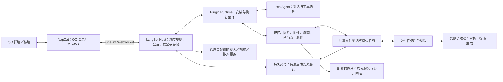

# 架构与维护

本项目把 QQ 接入、AI 对话和常用工具组合成一套部署配置。上游框架负责协议、模型和插件运行，本仓库维护配置向导、共享文件与任务基础、四个原创插件、两个定制插件及固定版本补丁。首次部署与日常启动以[根目录说明](../README.md)为准。

## 一条消息如何处理

新增优化集中在独立模块，保持原消息归属和工具调度链路：

| 模块 | 职责与边界 |
| --- | --- |
| `qunling/knowledge/` | 配置、按成员/群订阅范围隔离的资料、TTL/配额、租约与 Host 生命周期采集；不复用个人记忆库，不发送 QQ 消息 |
| `qunling/web_pages.py`、`web_search.py` | 前台工具与后台/主动自检共用实际网络实现；插件 `pkg` 保留兼容导出 |
| `qunling/files/cache.py`、`cache.py` | 可信父进程向隔离解析进程传递当前成员的 JSON 结构缓存；不传共享缓存路径或密码 |
| `qunling/memory_recall.py` | 成功注入记忆后，仅修改该次 LocalAgent 自动 RAG 选择；已授权资源及显式记忆工具权限保持完整 |
| `qunling/journal_writer.py`、`performance.py` | 顺序后台诊断写盘、分阶段耗时与有限窗口统计，不负责执行/重试业务 |
| `bootstrap/capabilities.py` | 管理员明确确认后执行有界自检，结果不包含密钥、模型原始响应或测试图片 |
| `deploy/updater/images.py` | 按可信仓库完整提交拉取镜像，验证来源、版本和平台后固定为摘要；保留原更新/恢复事务 |

`host-web-knowledge.patch` 接入机器人启动及管理路由；关闭时沿用现有 Host 生命周期钩子取消采集。`host-memory-recall.patch` 在授权资源建立之后调整本次自动检索，不修改持久流水线配置。知识检索仅在已决定回复的普通对话或已获准执行的查询中发生，不为每条群消息额外调用模型。

群聊默认需要 `@机器人` 或 `/ai` 前缀。每条群消息独立检查触发条件并排队，其他成员的普通发言不会替换正在处理的问题。模型需要前文时才通过工具读取锚点之前的同群历史；它不能指定任意群号或收件人。

工具调度按操作分成独立的有界通道：群前文、网页正文和状态查询等轻量读取最多并行 2 个，搜索／识图最多 1 个，生成、交付、文件处理及未知工具最多 1 个。每个通道最多保留 2 个执行或等待中的请求，避免长任务占满全部工具容量；模型执行名额保持独立。同一请求的工具仍串行，调用前重验身份与授权，排队期间操作类型改变时拒绝执行，取消和超时只归还本次实际取得的名额。这里按可信工具名称和操作参数调度，不根据群友发言的关键词改变对话方式。性能检查与下一步取舍见 [性能审查](PERFORMANCE.md)。

普通会话历史会保留稳定的说话人标记，避免把上一位成员的偏好、购买或要求归给当前提问者。工具返回的网页、文件正文和群聊引用都是待分析资料，不具有系统指令权限。

`qunling/proactive` 的轻量接话不直接调用工具；判断器用 `research` 处理资料讨论，`tool_followup` 处理公共话题查询续问，`task_request` 处理自然发起的明确执行请求。三者进入同一 Host 流水线，复用原始 ingress 的身份与一次性授权。查询默认只读，明确工具请求获得与普通 @ 请求相同的工具流程，不需要再次 @；授权位由 Host 绑定到原消息，不能从模型参数或 query variables 升级。模式、已选群、安静时段、预算和底层任务/文件归属检查继续生效，每次工具执行前重验授权。

轻量生成也可以发现前置判断遗漏的资料需求：它以封闭 JSON 返回正文、保持安静或申请 `research`，Host 仅提取正文用于发送；申请读取时不发送半成品草稿，而是重验原目标后进入上述只读流程。不能借此改换目标、取得执行权限或扩展到其他人的任务。按参与模式决定主动接话后，需要核对图片也可以读取，不必等群友再说一次“看图”；相关图片可来自其他成员或机器人自己，无关表情和已有文字足够的问题不必读图。

`group_batch.py` 为已判定的固定批次保存最多 8 条图片消息标识，按工作空间、机器人、群、请求者和原消息隔离；最多 128 份、15 分钟，不保存图片地址或像素。群图片读取与改图引用按这些标识补齐文字之后的图片和机器人自己的图片，重新校验 QQ 返回的群、消息 ID 和发送者。后续直播消息不会扩大旧快照。实际识图结果以 `image_analysis` 进入同群共享证据，发送回执仍单独作为 `image_delivery`，不会冒充视觉观察。

普通回复发送前，核对同群近期最多 8 条仍可验证的机器人答复，包括本批次开始前和处理期间发送的内容；中间穿插其他人的聊天不会清空已答证据。只有原问题与真实回执仍在可见短窗中，才交给语义判断核对问题、已发答案和草稿是否实质重复，不按说话人或关键词相似度判覆盖。只接受现有回执和完整候选覆盖，发送失败、无回执或核对失败都不能冒充已回答；新问题、补充条件和明确要求重新解释应继续响应。

每个待发草稿记录已核对的回执；等待模型、群内冷却或发送锁期间出现新回执，会在发送前继续核对，不因先前一次“保留”而跳过后来的答案。该步骤受原有并发名额、判断预算和问题时效限制，不持有发送锁调用模型，也不因新群友消息到达就中断当前任务。没有已发答案时不增加语义核对调用；核对输入仅包含对话证据，每条已发答案保留一次，不重复携带人设和调度配置。

## 组件与来源

| 组件 | 负责什么 | 本仓库的维护方式 |
| --- | --- | --- |
| LangBot 4.11.0 | 管理后台、OneBot 适配、流水线、模型、会话与存储 | 使用上游源码，应用受限补丁 |
| langbot-plugin 0.7.11 | SDK、CLI 和 Plugin Runtime | 固定兼容版本；SDK 与 Runtime 的许可不同 |
| NapCat | QQ 登录、事件与文件收发 | 使用官方部署产物，通过 OneBot 连接，不复制或修改其实现 |
| `langbot-team/LocalAgent` | 选择工具并组织模型回复 | 固定官方 0.2.1 源码，构建时应用有限继续补丁 |
| `langbot-team/LongTermMemory` | 长期画像与可检索记忆 | 基于官方 0.2.7 的本地修订 |
| `langbot-team/AIImagePlugin` | 自然语言生图与多图编辑 | 基于官方插件扩展 |
| `local/QQTextReader` | 文件导入、结构化读取、生成、任务查询和附件发送；保留 TXT 快捷入口 | 本项目原创插件，升级保留安装身份 |
| `local/QQComicTranslator` | 直接图片／漫画包翻译、后台任务与 LabelPlus 导出 | 本项目原创插件 |
| `local/QQGroupContext` | 同群近期多人讨论与图片理解 | 本项目原创插件 |
| `local/QQWebSearch` | 联网、搜图、文件列表与附件上传 | 本项目原创插件 |
| `qunling` | 文件权限与存储、持久任务、解析与产物、公共下载 | 本项目共享 Python 包，随插件和 Host 一起构建 |

七个插件是一个基于官方源码的 Agent、两个继承插件和四个原创插件。共享包不是第八个插件。保留继承插件的 `author/name` 是为了兼容安装身份和存储，不表示本地修改获得上游维护者背书。许可证与来源见[第三方说明](../THIRD_PARTY_NOTICES.md)。

## 共享文件与任务基础

QQ 附件、公开下载、明确选中的群历史图片和生成结果都可以登记为带权限范围的 `asset_ref`。`qunling.assets` 校验工作空间、机器人、会话、发送者和本轮可见性；后来的无关消息不会替换原提问的输入。原生文件身份由 QQ 适配层解析，网页下载复用公网地址校验，模型不能直接指定宿主路径或发送目的群。

`qunling.files` 不依赖 SDK，负责真实类型探测、结构导航、分页、检索、压缩包成员和明确 schema 的导出；插件仅负责输入适配、模型调用和交付。PDF/Office 解析依赖固定在 `qunling/requirements.txt`，7-Zip 随构建准备。支持范围和不能完整解析的内容见[功能说明](FEATURES.md#通用文件流程)与[库接口说明](../qunling/files/README.md)。

`qunling.jobs` 把参数和结果保存到共享数据目录，`qunling.tasks` 使用 SQLite 事务、租约及每次领取的凭证防止旧 worker 覆盖新任务。文件 daemon 默认并行处理 2 个任务，由 app 启动管理器托管；Host 退出时清理 daemon，daemon 异常退出时有限重启。它只运行本地固定文件操作，不自行向 QQ 发消息。

明确要求交付的生成／提取任务可登记持久 outbox，由 Host 根据原请求捕获的可信身份、路由和当前启用的 OneBot 发送；模型不能提供任意群号。工具参数 `deliver=true` 只用于用户要求发送的最终产物，中间文件默认不发送。任务完成和附件交付是不同状态，交付记录包括 `queued`、`started`、`sent`、`unconfirmed`、`cancelled`、`failed`；进程中断或超时后不能确认的发送保留为 `unconfirmed`，不盲目重发，也不承诺网络上的绝对恰好一次投递。

`gif_animation` 复用文件任务的 `create/gif` 操作。声明式图层、顺序图片与关键帧由 `qunling.animation` 在同一受限子进程中渲染，像素、输入总量、帧数、时长和产物大小有独立限制；不解释模型提供的 Python/JavaScript。每个 daemon 一次渲染一个 GIF，其他聊天流程继续运行。GIF 作为原始 Image 消息交付，避免文件上传或静态转换。原方案存入同 scope 的资产 metadata；字节相同但方案不同的产物保留不同引用，共享同一内容 blob。`QQGroupContext` 对动图生成有时间标记的关键帧拼图；抽样和前段读取不被描述为完整播放核验。

`AIImagePlugin` 可在原有 generate/edit 工具上携带 `gif_frames`，复用一次计费 claim 和原有超时预算。付款请求前校验可信文件上下文与原会话交付路由；一次生成 2×2 或 3×3 的分镜图，`qunling.ai_animation` 按行拆取前 2–6 个画面，原图先落盘再保存各帧，失败返回已完成部分。每帧最多 512×512，再提交同一 `create/gif` 后台队列和原群 outbox；工具本身不额外发图。生成分镜和拆帧受 10 MiB、1200 万像素限制，产物沿用文件工作区过期清理。LocalAgent 只接受该精确插件来源的任务续接元数据，续接查询不授权再次付费生图。

每次解析在清理后的环境、独立临时目录和子进程内运行，不向它传 AI/QQ 环境凭据，限制内存、CPU、运行时间及输出。XML、压缩包和生成参数另有结构、路径、膨胀比与大小校验。**这仍不是完整的操作系统文件系统／网络沙箱**，不提供任意代码执行、宏运行或浏览器自动化；部署进程和解析库仍属于需要信任、升级和隔离的组成部分。Box 默认关闭。

漫画翻译继续使用自己的有检查点任务管理器，避免改变既有付费请求的恢复语义。直接图片入口将授权图片预检后接入同一翻译流程，用户不必先压缩；普通文件任务不能据此自动恢复付费翻译或改图。

## 有限继续与网页证据

LocalAgent 每次对话最多 24 轮工具迭代。SDK 的工具来源字段用于识别受信插件，Agent 只接受明确允许的工具给出的结构化继续提示；网页正文、文件内容和其他插件伪造的字段不会取得此权限。提示受原目标、次数和期限约束，不会扩展工具权限，也不能自动重复费用或交付结果不明的动作。

网页读取保留本轮静态快照、页码偏移和来源阅读状态，支持继续正文、定位字面关键词或读取实际链接。搜索结果中的摘要、未读来源和已读正文分别标记；没有 JavaScript、登录态或自动操作网站的浏览器。网络层仅接受校验后的公网 URL，暂时性失败可以在有限预算内重试，拒绝原因会区分参数、权限、网络和需要换来源等情况。

## 部署与数据

推荐部署把 LangBot、Plugin Runtime 和 NapCat 放在容器内部网络。管理入口只绑定本机，再用 SSH 转发或自行配置的认证入口访问；Plugin Runtime 的控制、调试端口不应公开。常规聊天功能不启用 Box 沙箱。只有独立 updater 容器挂载 Docker socket；插件、Host 与设置网页均不直接获得该权限。

设置网页通过内部认证接口请求 updater 检查配置仓库的 `main` 提交、更新到固定 SHA。updater 负责拉取并核对该提交的预构建镜像（不可用时构建）、停止业务服务、备份五个业务卷、替换镜像和健康检查；失败时尝试恢复旧镜像和数据。`update-data` 卷保存工作状态与备份，源码只在更新工作目录中准备，不覆盖用户下载的项目目录。这个服务具有 Docker 管理权限，来源仓库必须由管理员信任。

| 数据 | 保存位置或生命周期 | 迁移时的处理 |
| --- | --- | --- |
| 提供方密钥、模型、流水线与插件配置 | LangBot 数据目录 | 作为私有数据备份，不提交到 Git |
| 对话与长期记忆 | LangBot 数据库、插件存储与向量库 | 一并备份，保留插件身份和知识库关联 |
| QQ 登录状态与 NapCat 配置 | NapCat 持久化目录 | 作为私有数据备份，不能公开分享 |
| 群聊快照、旧 TXT 快捷引用和网页编号 | 临时上下文，有过期时间 | 重启后可能需要重新引用或查询 |
| 已导入文件、生成产物、文件任务及交付回执 | LangBot 数据目录下 `qunling/`；文件与结束任务默认保留 7 天，分别受存储配额限制 | 包含在 `langbot-data` 卷备份中；不是永久归档 |
| 漫画任务与部分译文 | 插件持久存储 | 重启后由原发送者明确要求继续 |
| 明确请求诊断元数据 | `QUNLING_DATA_DIR/requests/`，按实例独立 SQLite；结束记录保留 7 天、最多 2,000 条 | 包含在 LangBot 数据卷备份中；重启标记遗留请求，不重放操作 |
| 运行日志、安装包、虚拟环境 | 本地运行目录 | 排除版本管理；跨系统重新构建依赖 |
| 更新状态与自动备份 | Docker `update-data` 命名卷 | 私有资料，失败现场保留；不能代替异机备份 |

AI 服务由部署者提供。本项目不包含模型额度或公共 API Key。聊天、图片编辑、搜索和嵌入接口的能力并不相同：仅支持聊天的网关未必支持图像编辑或 Responses 联网搜索。

## 如何修改

| 位置 | 责任 |
| --- | --- |
| 根目录 `.cmd`、`bot.sh` | 用户可直接使用的启动入口 |
| `scripts/` | 维护、补丁、旧原生配置和合成验证；数据路径仍相对项目根目录 |
| `bootstrap/` | 设置 UI、初始化幂等逻辑、AI 配置、更新请求代理 |
| `deploy/compose/` | 镜像构建、可信来源清单、容器初始化和离线检查 |
| `deploy/updater/` | 独立的容器更新控制与备份恢复 |
| `custom-plugins/` | 本地维护的六个插件；业务逻辑优先在这里扩展 |
| `qunling/` | 共享文件、任务、下载与交付机制；新增通用格式在此维护 |
| `patches/`、`config/` | 上游兼容差异与通用回答风格 |
| `tests/` | 部署、权限、路径和传输契约回归 |

- 回答风格：编辑 `config/chat-style.txt`，再通过配置入口应用；无需改框架。
- 增加业务功能：通用机制放 `qunling/`，QQ／模型相关适配放 `custom-plugins/`，测试后重新构建。不要复制多套解析、下载和任务状态实现。
- 兼容框架缺陷：在 `patches/` 中维护最小补丁，通过 `scripts/Apply-RuntimePatches.py` 检查；默认只检查，显式 `--apply` 才修改。
- 变更模型或 API：优先使用配置向导，自动同步聊天、视觉、生图和搜索配置。直接在高级管理后台修改提供方时，不会自动同步插件中的独立配置。

不要编辑 `data/plugin-runtime/artifacts/sha256/` 下的运行缓存。源码目录不是已安装插件的实时挂载，修改源码后必须重新构建、安装；改变 Host 或 SDK 后必须重启对应进程。

请求诊断由 `qunling/request_journal.py` 维护，`qq_dispatch` 记录队列与生命周期，`host-request-diagnostics.patch` 接入流水线阶段、原始异常类别及插件工具调用。管理接口 `GET /api/v1/platform/bots/{bot_uuid}/requests` 要求 `resource.manage`，在当前工作区验证机器人及实例绑定，设置页通过已认证的 `/api/requests` 代理读取。它是部署者诊断入口，不向模型或插件提供额外读取权限。

`request_recovery.py` 只接受明确的插件来源与只读操作组合；每次尝试重新检查当前执行权限。取消向上传播，失败最多重试一次，不重放整个模型轮次或结果不明的发送。持久日志保存有限状态码与路由标识，不保存异常原文、模型提示词或工具参数；日志写入失败仅降级诊断，不重试业务操作。

## 补丁边界

Host 补丁修复群聊触发与成员隔离、说话人历史、OneBot 图片和文件读取、记忆删除以及图片工具的等待预算。SDK／Runtime 补丁补充受控后台任务、图片调用等待、Windows 安装路径、附件消息容量与工具来源字段。LocalAgent 的有限继续补丁只应用于锁定的官方源码临时构建目录，限定修改文件并校验正反向应用，不编辑运行缓存。

跨平台安装器根据目标 Python 的实际 `site-packages` 路径工作。已经应用的补丁会跳过，版本不匹配时停止；不会强制覆盖未知源码。Windows 安装器补丁在 Linux 上跳过。升级上游版本前应先验证兼容性，不能只改版本号后重复应用旧补丁。

20 MiB 附件经 base64 后约 26.67 MiB，因此本项目将 Runtime 单条消息预算设为 32 MiB；片段数量、下载和缓存限制仍独立保留。该设置会影响 Runtime 全部消息，而非只影响附件。

验证分为公开源码测试、实际镜像内离线插件／文件任务测试、容器初始化及更新恢复测试，以及使用部署者自己的 QQ 和 AI 服务做实际收发验收。以对应提交的运行结果为准；新增文件与任务代码的本机测试通过不表示新 Linux 镜像已经验收。网页更新、模型能力和实际聊天收发需要分别确认。

上游参考：[LangBot 4.11.0 Compose](https://github.com/langbot-app/LangBot/blob/v4.11.0/docker/docker-compose.yaml)、[SDK 0.7.11](https://github.com/langbot-app/langbot-plugin-sdk/tree/v0.7.11)、[NapCat 官方 Docker](https://github.com/NapNeko/NapCat-Docker)。
