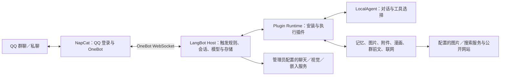

# 架构与维护

本项目把 QQ 接入、AI 对话和常用工具组合成一套部署配置。上游框架负责协议、模型和插件运行，本仓库维护配置向导、四个原创插件、两个定制插件及少量兼容补丁。首次部署与日常启动以[根目录说明](../README.md)为准。

## 一条消息如何处理

群聊默认需要 `@机器人` 或 `/ai` 前缀。每条群消息独立检查触发条件并排队，其他成员的普通发言不会替换正在处理的问题。模型需要前文时才通过工具读取锚点之前的同群历史；它不能指定任意群号或收件人。

普通会话历史会保留稳定的说话人标记，避免把上一位成员的偏好、购买或要求归给当前提问者。工具返回的网页、文件正文和群聊引用都是待分析资料，不具有系统指令权限。

## 组件与来源

| 组件 | 负责什么 | 本仓库的维护方式 |
| --- | --- | --- |
| LangBot 4.11.0 | 管理后台、OneBot 适配、流水线、模型、会话与存储 | 使用上游源码，应用受限补丁 |
| langbot-plugin 0.7.11 | SDK、CLI 和 Plugin Runtime | 固定兼容版本；SDK 与 Runtime 的许可不同 |
| NapCat | QQ 登录、事件与文件收发 | 使用官方部署产物，通过 OneBot 连接，不复制或修改其实现 |
| `langbot-team/LocalAgent` | 选择工具并组织模型回复 | 使用官方插件 |
| `langbot-team/LongTermMemory` | 长期画像与可检索记忆 | 基于官方 0.2.7 的本地修订 |
| `langbot-team/AIImagePlugin` | 自然语言生图与多图编辑 | 基于官方插件扩展 |
| `local/QQTextReader` | 读取当前、引用或本人近期 TXT | 本项目原创插件 |
| `local/QQComicTranslator` | 压缩包漫画翻译、后台任务与 LabelPlus 导出 | 本项目原创插件 |
| `local/QQGroupContext` | 同群近期多人讨论与图片理解 | 本项目原创插件 |
| `local/QQWebSearch` | 联网、搜图、文件列表与附件上传 | 本项目原创插件 |

七个插件是一个官方 Agent、两个继承插件和四个原创插件。保留继承插件的 `author/name` 是为了兼容安装身份和存储，不表示本地修改获得上游维护者背书。许可证与来源见[第三方说明](../THIRD_PARTY_NOTICES.md)。

## 部署与数据

推荐部署把 LangBot、Plugin Runtime 和 NapCat 放在容器内部网络。管理入口只绑定本机，再用 SSH 转发或自行配置的认证入口访问；Plugin Runtime 的控制、调试端口不应公开。常规聊天功能不启用 Box 沙箱。只有独立 updater 容器挂载 Docker socket；插件、Host 与设置网页均不直接获得该权限。

设置网页通过内部认证接口请求 updater 检查配置仓库的 `main` 提交、更新到固定 SHA。updater 负责构建、停止业务服务、备份五个业务卷、替换镜像和健康检查；失败时尝试恢复旧镜像和数据。`update-data` 卷保存工作状态与备份，源码只在更新工作目录中准备，不覆盖用户下载的项目目录。这个服务具有 Docker 管理权限，来源仓库必须由管理员信任。

| 数据 | 保存位置或生命周期 | 迁移时的处理 |
| --- | --- | --- |
| 提供方密钥、模型、流水线与插件配置 | LangBot 数据目录 | 作为私有数据备份，不提交到 Git |
| 对话与长期记忆 | LangBot 数据库、插件存储与向量库 | 一并备份，保留插件身份和知识库关联 |
| QQ 登录状态与 NapCat 配置 | NapCat 持久化目录 | 作为私有数据备份，不能公开分享 |
| 近期 TXT、图片和联网附件编号 | 插件内存，有过期时间 | 重启后需要重新上传或查询 |
| 漫画任务与部分译文 | 插件持久存储 | 重启后由原发送者明确要求继续 |
| 运行日志、安装包、虚拟环境 | 本地运行目录 | 排除版本管理；跨系统重新构建依赖 |
| 更新状态与自动备份 | Docker `update-data` 命名卷 | 私有资料，失败现场保留；不能代替异机备份 |

AI 服务由部署者提供。本项目不包含模型额度或公共 API Key。聊天、图片编辑、搜索和嵌入接口的能力并不相同：仅支持聊天的网关未必支持图像编辑或 Responses 联网搜索。

## 如何修改

| 位置 | 责任 |
| --- | --- |
| 根目录 `.cmd`、`bot.sh` | 用户可直接使用的启动入口 |
| `scripts/` | 维护、补丁、旧原生配置和合成验证；数据路径仍相对项目根目录 |
| `bootstrap/` | 设置 UI、初始化幂等逻辑、AI 配置、更新请求代理 |
| `deploy/compose/` | 镜像构建、可信来源清单、容器初始化和离线检查 |
| `deploy/updater/` | 独立的容器更新控制与备份恢复 |
| `custom-plugins/` | 本地维护的六个插件；业务逻辑优先在这里扩展 |
| `patches/`、`config/` | 上游兼容差异与通用回答风格 |
| `tests/` | 部署、权限、路径和传输契约回归 |

- 回答风格：编辑 `config/chat-style.txt`，再通过配置入口应用；无需改框架。
- 增加业务功能：在 `custom-plugins/` 中维护插件源码，测试、重新打包并安装。
- 兼容框架缺陷：在 `patches/` 中维护最小补丁，通过 `scripts/Apply-RuntimePatches.py` 检查；默认只检查，显式 `--apply` 才修改。
- 变更模型或 API：优先使用配置向导，自动同步聊天、视觉、生图和搜索配置。直接在高级管理后台修改提供方时，不会自动同步插件中的独立配置。

不要编辑 `data/plugin-runtime/artifacts/sha256/` 下的运行缓存。源码目录不是已安装插件的实时挂载，修改源码后必须重新构建、安装；改变 Host 或 SDK 后必须重启对应进程。

## 补丁边界

Host 补丁修复群聊触发与成员隔离、说话人历史、OneBot 图片和文件读取、记忆删除以及图片工具的等待预算。SDK／Runtime 补丁补充受控后台任务、图片调用等待、Windows 安装路径和附件消息容量。

跨平台安装器根据目标 Python 的实际 `site-packages` 路径工作。已经应用的补丁会跳过，版本不匹配时停止；不会强制覆盖未知源码。Windows 安装器补丁在 Linux 上跳过。升级上游版本前应先验证兼容性，不能只改版本号后重复应用旧补丁。

20 MiB 附件经 base64 后约 26.67 MiB，因此本项目将 Runtime 单条消息预算设为 32 MiB；片段数量、下载和缓存限制仍独立保留。该设置会影响 Runtime 全部消息，而非只影响附件。

Windows 本机已有离线与合成集成验证；Linux amd64 Docker 已完成构建、初始化、插件和 QQ 连通验证。每个新部署仍需确认自己的 AI 服务支持所选能力，完成 QQ 登录和一次小型收发检查。网页更新的验证结果与聊天能力的验证分开记录，不能以离线用例代替真实容器恢复验收。

上游参考：[LangBot 4.11.0 Compose](https://github.com/langbot-app/LangBot/blob/v4.11.0/docker/docker-compose.yaml)、[SDK 0.7.11](https://github.com/langbot-app/langbot-plugin-sdk/tree/v0.7.11)、[NapCat 官方 Docker](https://github.com/NapNeko/NapCat-Docker)。
